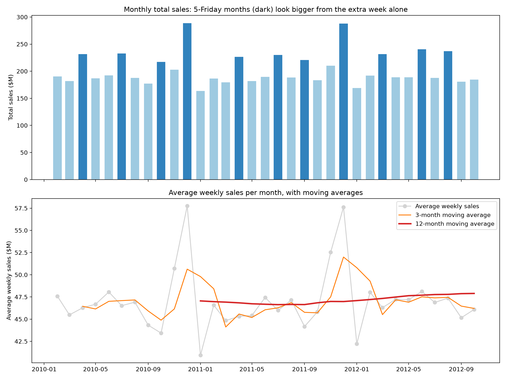
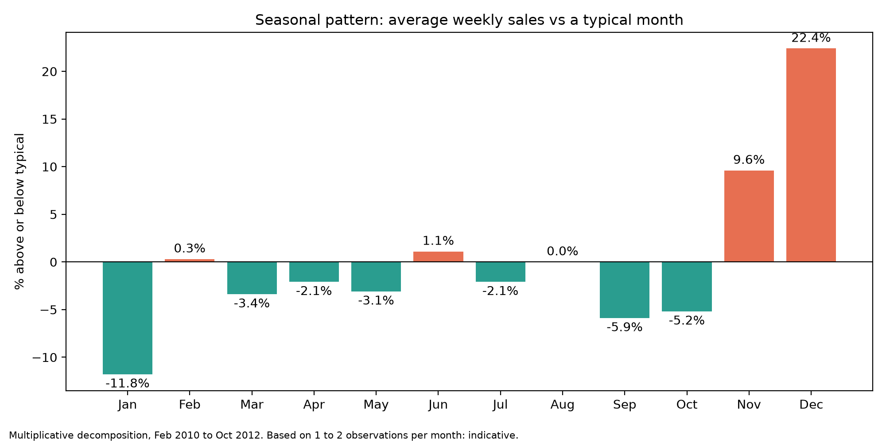
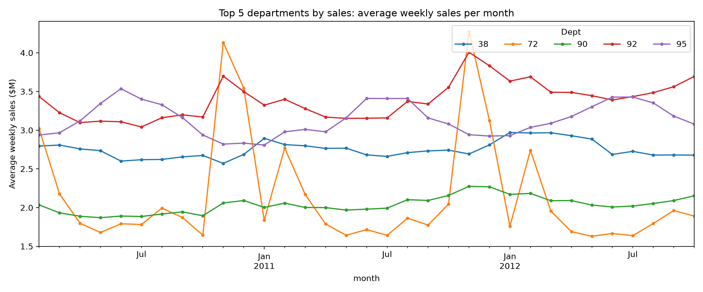
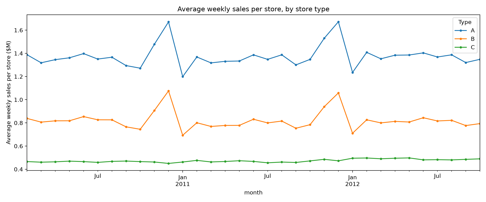
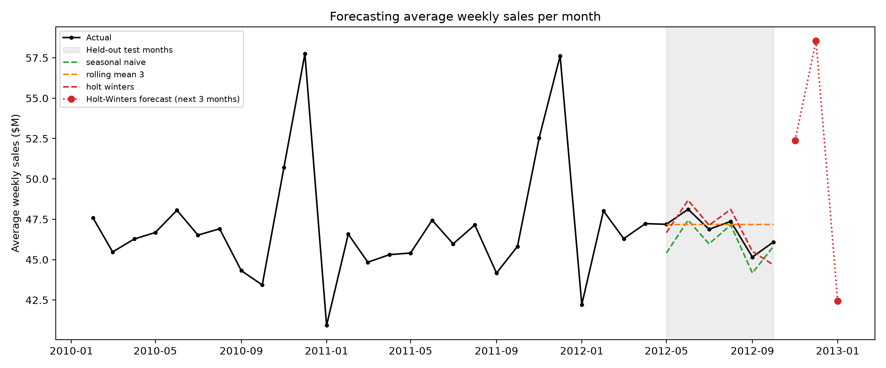

# Walmart Sales: Time Series Breakdown
 
Elevvo Data Analytics Internship, Task 7 (Level 3): Time Series Breakdown of Retail Sales.
 
**Business question:** How do Walmart's sales change over time (trend and seasonality), and which departments and stores drive them?
 
**Answer in one line:** The underlying sales level is nearly flat (about +1% a year), and almost all of the seasonality is a short holiday peak: December runs about 22% above the yearly trend, and the Thanksgiving week alone sells about 40% more than an average week.
 

 
## Key results
 
| Finding | Result |
|---|---|
| Data | 421,570 weekly rows, 45 stores, 81 departments, 143 Fridays (Feb 2010 to Oct 2012) |
| Total sales | $6,737M (average week: $47.1M) |
| Biggest week | Friday Dec 24, 2010: $80.9M |
| Underlying trend | 12-month moving average $47.05M to $47.90M (+1.8% over 21 months) |
| Seasonal index (vs trend) | December +22.4%, November +9.6%, January -11.8% |
| Thanksgiving week vs average week | +40.5% |
| Department concentration | Dept 92 is the largest (7.2% of sales); 12 of 81 departments produce 50% of sales, 29 produce 80% |
| Most seasonal departments | Dept 7 (2.75x), Dept 5 (2.28x), Dept 72 (1.94x): Nov to Dec vs Feb to Oct |
| Store types | Type A: 22 stores, 64.3% of sales; B: 17 stores, 29.7%; C: 6 stores, 6.0% |
| Best forecast method | Holt-Winters, MAPE 1.38% on 6 held-out months (naive: 1.67%) |
 
## What this project covers
 
- **Trend:** monthly average weekly sales with 3 and 12 month moving averages, and year-over-year change.
- **Seasonality:** seasonal index by calendar month (multiplicative decomposition) and a look at holiday-flagged weeks.
- **Breakdown by product:** sales concentration and seasonality by department.
- **Breakdown by region:** sales by store and store type, per store and per square foot.
- **Bonus, simple forecasting:** naive, rolling mean, seasonal naive and Holt-Winters exponential smoothing, compared on held-out months.

 

 

 

 
## Repository structure
 
```
walmart_sales_time_series/
├── data/
│   ├── raw/             # Kaggle files (not committed)
│   └── processed/       # monthly table generated by the notebook (not committed)
├── notebooks/
│   └── 01_time_series_analysis.ipynb
├── outputs/             # charts
├── README.md
└── requirements.txt
```
 
## Data
 
[Walmart Recruiting: Store Sales Forecasting](https://www.kaggle.com/c/walmart-recruiting-store-sales-forecasting/overview) (Kaggle competition). Download `train.csv` and `stores.csv` and place them in `data/raw/` (the notebook reads `train.csv.zip` directly, so leave it zipped if that is how you downloaded it). Kaggle may ask you to accept the competition rules first. The raw data is not committed to this repository.
 
## How to run
 
1. `pip install -r requirements.txt`
2. Put the Kaggle files in `data/raw/`.
3. Run `notebooks/01_time_series_analysis.ipynb` from top to bottom. It writes the charts to `outputs/`.
## Methodology
 
- The data is weekly and every date is a Friday. The holiday flags fall on weeks ending around each holiday, so the Friday is treated as a **week-ending date** (an inference, not documented in the files). Each week is assigned to the month in which it ends.
- Months have 4 or 5 Fridays, which makes monthly totals jagged (a 5-week month looks about 25% bigger from the extra week alone). The main monthly measure is therefore **average weekly sales**, with totals shown alongside.
- Negative sales rows (1,285, likely returns or corrections) are kept so totals are net sales. They sum to -0.001% of total sales.
- Moving averages are trailing (each value uses only past months). The seasonal index comes from multiplicative decomposition with a 12-month period, and a robustness check using only the series present in all 143 weeks (99.1% of sales) gives monthly averages within about 2% to 3% of the all-series figures.
- "Product" means department number and "region" means store number and store type. Both are anonymized in the dataset, so findings are by number only.
- Forecast: trained on Feb 2010 to Apr 2012 (27 months) and tested on May to Oct 2012 (6 months). Holt-Winters uses multiplicative seasonality and no trend.
## Limitations
 
- The data covers only 33 months, so each calendar month rests on 1 to 3 observations (November and December appear twice) and the seasonal index is indicative.
- Sales are in nominal dollars and are not adjusted for inflation.
- The number of store-department series reporting varies by about 4% from week to week. Sales per square foot assumes `Size` is square feet, and Type C stores carry fewer departments (62 vs 76 for A and B), so that comparison is not like-for-like.
- The forecast test window (May to Oct 2012) contains no holiday months, so it cannot show whether a method captures the November and December peak. The Nov 2012 to Jan 2013 forecast is illustrative only and has no prediction intervals.
- Findings are descriptive: the data does not explain why sales moved.
## Tools
 
Python (pandas, NumPy, matplotlib, statsmodels), Jupyter.
 

